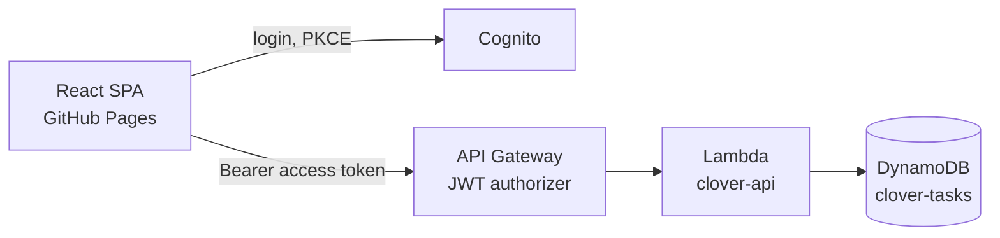

# 🍀 clover

A simple todo app.

<!-- demo gif -->

## Description

Organize tasks into lists, break them into steps, and set due dates, priority, and stage. The Today view shows what's due now, and drag and drop handles reordering.

## Stack

- Frontend: React + TypeScript (Vite, Tailwind)
- Backend: Python Lambda, DynamoDB, Cognito
- Infra: Terraform on AWS

## Layout

```
frontend/  React SPA
backend/   Python Lambda API
shared/    limits and enums used by both
infra/     Terraform
```

## Architecture


